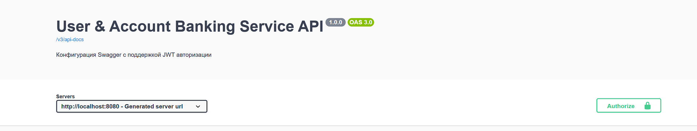

# Инструкция по запуску приложения

Для успешного запуска проекта и настройки окружения последовательно выполните следующие шаги.

## 🚀 Быстрый старт

### Шаг 1: Запуск инфраструктуры (Docker)
Запустите необходимые контейнеры (базу данных, брокеры сообщений и т.д.) в фоновом режиме:
```bash
docker-compose up -d
```
Если необходимо очистить данные перед перезапуском контейнеров, выполнить команду:
```bash
docker-compose down -v
```

### Шаг 2: Применение миграций базы данных
Выполните миграцию схемы БД с помощью Liquibase:
```bash
mvn liquibase:update
```

### Шаг 3: Запуск приложения
Запустите само приложение. Используйте команду в зависимости от вашего стека:

**Для Spring Boot / Maven:**
```bash
mvn spring-boot:run
```
*(Или запустите класс с методом `main()` напрямую через вашу IDE).*

### Шаг 4: Тестирование API (Swagger UI)
После успешного запуска приложения перейдите в браузер по ссылке для просмотра и тестирования доступных эндпоинтов:
👉 http://localhost:8080/swagger-ui/index.html
---

## 🔑 Авторизация

После успешного запуска приложения вы можете авторизоваться в системе. Доступно два альтернативных способа входа:

1. **По адресу электронной почты:**
    * **Логин:** `email`
    * **Пароль:** `password`

2. **По номеру телефона:**
    * **Логин:** `phone`
    * **Пароль:** `password`



3. **Ввести токен в поле authorization, все последующие запросы будут будут проходить от лица авторизованного пользователя**